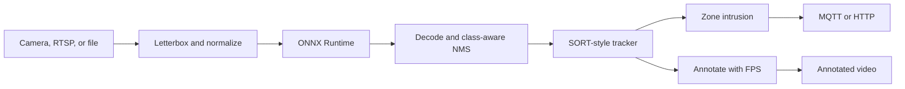

# edge-vision-detector

Portfolio demo of a real-time object-detection pipeline aimed at edge devices (NVIDIA Jetson, Raspberry Pi, or any machine with ONNX Runtime). It reads a camera, an RTSP URL, or a video file, runs a YOLO model exported to ONNX, tracks boxes with a small SORT-style filter, and publishes zone-enter / zone-exit events over HTTP or MQTT.

This is a readable Python pipeline for a public GitHub profile, not a production safety system and not a replacement for NVIDIA DeepStream. The numbers in [Benchmarks](#benchmarks) were measured on one CPU virtual machine. Nothing in this repository was timed on a Jetson or a Raspberry Pi.

The Python code is [MIT](LICENSE). The YOLOv8n weights the download script fetches are not included here and are under a different license (Ultralytics YOLOv8 is AGPL-3.0).

## Features

- Capture from a video file, a V4L2/camera index, or an RTSP URL (`OpenCV` `VideoCapture`; RTSP sets a small buffer).
- ONNX Runtime session with a selectable provider list (`CPUExecutionProvider`, `CUDAExecutionProvider`, `TensorrtExecutionProvider`). Missing providers are skipped and CPU is kept as a fallback when the runtime has it.
- YOLOv8 (no objectness), YOLOv5 (with objectness), and end-to-end `(N, 6)` rows. Layout is `auto` or set in the config.
- Letterbox preprocessing and class-aware greedy NMS.
- Multi-object tracker: constant-velocity Kalman filter on the box, greedy IoU association, class-gated. Not the Hungarian solver from the SORT paper.
- Polygon zones. An alert fires when a confirmed track's foot point (bottom-center of the box) enters or leaves. One event per edge, not every frame.
- HTTP POST or MQTT publish. A dead broker is logged and does not stop the capture loop. MQTT connection failures still fail at startup.
- Annotated MP4 (boxes, ids, zones, FPS, latency) and per-stage latency (preprocess, inference, postprocess, track, total).
- YAML config and a small CLI (`run`, `bench`).
- Synthetic clip and PNG frames so capture can be tried without a camera. Those shapes are not a COCO scene.
- CPU-only pytest suite that does not download a model. GitHub Actions runs it.

## Architecture



The loop is synchronous and single-stream. Each frame is letterboxed to the network input, run through the ONNX session, decoded, associated to existing tracks, then checked against polygons. The active provider is whatever this ONNX Runtime build actually loaded. CI and the benchmark below use `CPUExecutionProvider`.

## Layout

```
configs/                 default, camera, and RTSP YAML
deploy/Dockerfile.jetson unverified Jetson/L4T starting point
src/edge_vision/         capture, preprocess, NMS, tracker, zones, publish
scripts/download_model.py
scripts/export_model.py  optional; needs the export extra
scripts/make_sample_video.py
samples/                 synthetic.mp4 and a few PNGs
tests/                   no GPU, no weight download
```

## Run

Requires Python 3.10+ and a machine that can install the wheels in `pyproject.toml` (numpy, OpenCV headless, onnxruntime, PyYAML, paho-mqtt).

```bash
python -m venv .venv
source .venv/bin/activate
pip install -e ".[dev]"

python scripts/download_model.py          # models/yolov8n.onnx, about 12.8 MB
python scripts/make_sample_video.py       # already generated in samples/

python -m edge_vision run --config configs/default.yaml --max-frames 60
python -m edge_vision bench --config configs/default.yaml --frames 30 --warmup 8
python -m pytest
```

Paths in the YAML are relative to the working directory. Run the commands from the repo root.

Camera and RTSP configs are `configs/camera.yaml` and `configs/rtsp.yaml`. Override the file source or the provider list without editing YAML:

```bash
python -m edge_vision run --config configs/default.yaml --source /path/to/clip.mp4
python -m edge_vision run --config configs/default.yaml --provider CUDAExecutionProvider
```

`publish.mode` is `none`, `http`, or `mqtt`. HTTP posts one JSON object per event. MQTT publishes the same payload on `publish.mqtt.topic`.

```json
{
  "event": "zone_enter",
  "zone": "doorway",
  "track_id": 3,
  "class_id": 0,
  "class_name": "person",
  "score": 0.91,
  "bbox": [0, 0, 10, 20],
  "timestamp": "2026-10-15T00:00:00.000Z"
}
```

`zone_exit` uses the same fields. Zones with an empty `classes` list match every class. A name or a class id both work. `min_hits` (default 3) holds a track back until it has been seen that many times. A confirmed track that disappears for more than `max_age` frames is dropped; ids are not reused.

To export your own ONNX instead of downloading one (this pulls PyTorch via Ultralytics and is not part of the default install or CI):

```bash
pip install -e ".[export]"
python scripts/export_model.py --weights yolov8n.pt --output models/yolov8n.onnx --imgsz 640
```

`model.input_size` is `[height, width]` and must match a static ONNX input. The downloaded YOLOv8n file is `1x3x640x640` with output `1x84x8400`.

### Docker

CPU image. The weight file is not baked in; mount it.

```bash
docker build -t edge-vision .
docker run --rm \
  -v "$PWD/models:/app/models" \
  -v "$PWD/output:/app/output" \
  edge-vision run --config configs/default.yaml --max-frames 60
```

This image was not built in the environment used to prepare the demo (no Docker daemon there).

### Jetson and Raspberry Pi

`deploy/Dockerfile.jetson` is a starting point for JetPack 6 / L4T r36. It was not built or run on a Jetson for this repo. Pick a base tag that matches the board (`cat /etc/nv_tegra_release`); the file's default `nvcr.io/nvidia/l4t-jetpack:r36.4.0` is an example, not a result. The PyPI `onnxruntime` wheel is CPU-only. CUDA and TensorRT execution providers on Jetson come from a JetPack-matched build. Install that runtime first if you need `TensorrtExecutionProvider` or `CUDAExecutionProvider`, then put those names first in `model.providers`.

On a 64-bit Raspberry Pi, install the same Python package and leave the provider on `CPUExecutionProvider`. Capture goes through OpenCV. A camera that shows up as `/dev/video0` can use `configs/camera.yaml`. A libcamera-only device is not set up by this demo; bridge it to V4L2 (for example with `libcamerify`) or the open will fail. No Pi or Jetson timings are listed below.

## Benchmarks

One run each, measured on 2026-10-15 while preparing this repo. Not a Jetson, not a Raspberry Pi, not a GPU.

| | |
| --- | --- |
| Machine | KVM guest, 4 vCPU, `Intel(R) Xeon(R) Processor` (family 6, model 207; no SKU in `/proc/cpuinfo`) |
| Memory | `MemTotal` 16387332 kB |
| OS | Linux 6.12.94+ (`Linux-6.12.94+-x86_64-with-glibc2.39`) |
| Software | Python 3.12.3, onnxruntime 1.31.0, OpenCV 5.0.0, `CPUExecutionProvider`, default session threads |
| Model | YOLOv8n ONNX, 12805802 bytes, sha1 `68f864475d06e2ec4037181052739f268eeac38d`, input `1x3x640x640`, output `1x84x8400` |
| Frames | `samples/synthetic.mp4`, 640x480, letterboxed to 640x640 |
| Detections | 0. The clip is moving rectangles, so this is throughput, not accuracy |

Processing only (`python -m edge_vision bench --config configs/default.yaml --frames 30 --warmup 8`). Annotated video was turned off. 8 warmup frames are excluded. Wall time for the 30 measured frames was 0.906 s, **33.12 FPS**.

| stage | mean ms | p50 ms | p95 ms |
| --- | ---: | ---: | ---: |
| preprocess | 3.46 | 3.45 | 3.81 |
| inference | 24.25 | 23.95 | 27.23 |
| postprocess | 1.43 | 1.44 | 1.64 |
| track | 0.04 | 0.04 | 0.04 |
| total | 29.60 | 29.34 | 33.11 |

Same model and machine, writing `output/annotated.mp4` (`python -m edge_vision run --config configs/default.yaml --max-frames 20`, no warmup): **29.89 FPS** over 20 frames. Stage times from that run: inference mean 24.50 ms (p50 23.43, p95 28.10); total mean 32.78 ms (p50 30.30, p95 37.48).

CUDA was requested once on this host (`--provider CUDAExecutionProvider`). ONNX Runtime 1.31.0 here only has `CPUExecutionProvider` (plus `AzureExecutionProvider`, which the demo does not request). The process logged the missing provider and ran on CPU. That fallback was not used as a timing result.

## Tests

`python -m pytest` covers letterbox and RGB normalization, YOLOv8 / YOLOv5 / end-to-end decode, class-aware NMS (including the IoU threshold boundary), the tracker (confirmation, id stability, max age, class gating), zone enter/exit on the foot point, HTTP and MQTT publishers (local server and an injected client; no broker), provider selection, config parsing, file capture, and a pipeline run with a scripted detector. A fake ONNX session checks the detector glue. None of that downloads weights or needs a GPU.

GitHub Actions (`.github/workflows/ci.yml`) installs the package on Python 3.11 and runs pytest. The suite above was also run locally on Python 3.12.3: 42 passed.

## Limits

- Greedy IoU association. Overlapping tracks of the same class can swap ids. There is no appearance embedding.
- A track that vanishes while inside a zone does not emit `zone_exit`. The next time that id is seen inside, a new enter is emitted.
- Single camera, one thread, one model. No batching and no multi-stream.
- Scores are treated as probabilities, which matches an Ultralytics ONNX export. A head that still emits logits will threshold badly until you set the layout and export correctly.
- TensorRT and CUDA are selectable only when the installed ONNX Runtime exposes them. This repo's CI wheel does not.
- Zone coordinates in the sample config are an example for a 640x480 frame, not a calibrated camera.

## License

MIT for the code in this repository. See [LICENSE](LICENSE). Model files downloaded by `scripts/download_model.py` stay out of git and keep their own license.
